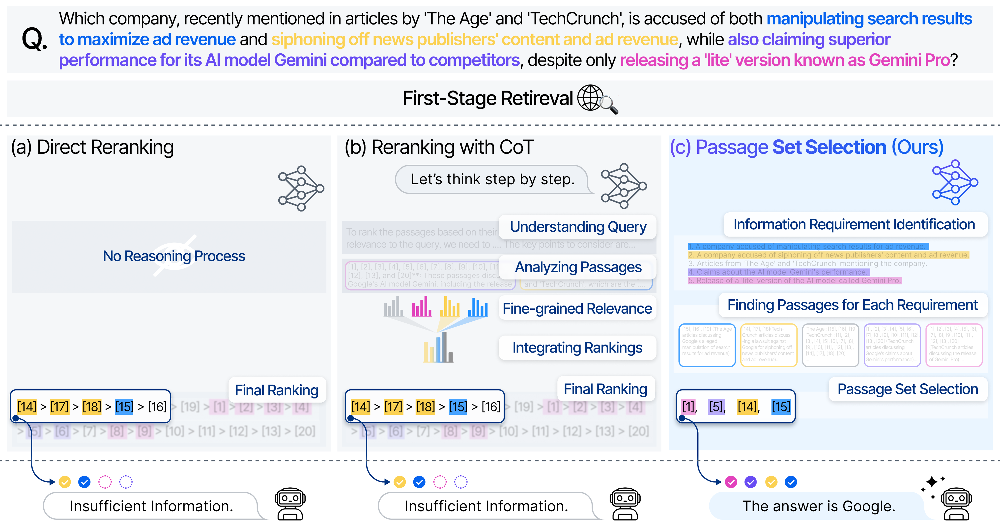

# SetR
This repository contains the official implementation of **[SetR: Shifting from Reranking to Passage Set Selection for Retrieval-Augmented Generation](https://arxiv.org/abs/2507.06838)**, a novel approach that redefines how retrieval-augmented generation (RAG) systems leverage retrieved passages by selecting *sets of passages* instead of reranking individual ones. SetR introduces a set-level selection framework that significantly improves downstream generation quality while maintaining efficiency.

📢 This work has been **accepted for an oral presentation at ACL 2025**.




## Installation
To install the required dependencies, run:

```
pip install -r requirements_local.txt
pip install flash-attn==2.4.2 --no-build-isolation
```

## Usage

> [!WARNING] 
> Before running the scripts, make sure to update all file and directory paths as needed.
> For example, replace:
> ```
> volume='/path/to/your/model/directory'
> ```
> with the path to your actual directory.


### Step 1. Generate training data


> [!NOTE]
> Our training data is primarily sourced from `castorini/rank_zephyr_training_data`, with additional parsing to extract passages and queries from user conversations. The processed dataset is available at `/train_data/rank_zephyr_training_data-parsed.jsonl`.
Since the model answers in the conversations field are directly inherited from `castorini/rank_zephyr_training_data`, to reproduce SetR you need to run generate_data.py on the parsed file and generate new responses based on the SetR instruction.

> [!TIP] 
> If you want to collect responses from open-source or other LLMs, please edit the client section in `generate_data.py` to fit your setup. All prompts are provided in generate_data.py, so you can easily modify the prompt modes to reproduce ablation studies.

```
pip install -r requirements_local.txt
./train_data_generation.sh
```

### Step 2. Train the model (docker)
```
./run_docker.sh

# inside the docker
pip install -r requirements_docker.txt
pip install flash-attn==2.4.2 --no-build-isolation

# wandb login (if use)
# huggingface-cli login (if use)
# run training script
./train_llama_3.1_8B_inst_gcp.sh
```

### Step 3. Generate model responses for evaluation
> [!NOTE]
> This step is the almost same as for generating training data.
> You can update the IR results if needed — we provide `simple_retrieval.py` for this purpose.
> Feel free to review and modify it as needed for your own use.
```
./eval_data_generation.sh
```

> [!NOTE]
> Convert response data to rankify format. Below is the example script:
```
./convert_rankify_example.sh
```

### Step 4. Evaluation
```
TBD
```

## Contact
Feel free to post an issue, submit a pull request, or reach out with questions at:
leedhn@lgresearch.ai, yongrae.jo@lgresearch.ai, haeju.park@lgresearch.ai

## Citation

If you find this work useful, please cite:
```
@inproceedings{lee2025setr,
  title     = {Shifting from Reranking to Passage Set Selection for Retrieval-Augmented Generation},
  author    = {Lee, Dahyun and Jo, Yongrae and Park, Haeju and Lee, Moontae},
  booktitle = {Proceedings of the 63rd Annual Meeting of the Association for Computational Linguistics (ACL)},
  year      = {2025}
}
```